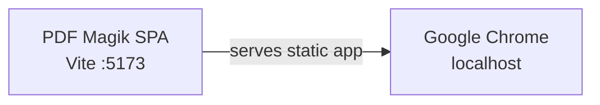

# Azure Debug Plan

> This plan is the source of truth for generating the VS Code debug setup in this workspace.
>
> **Status:** Implemented
> **Execution Mode:** Guided
> **Created:** 2026-10-30T14:27:53+05:00
> **Last Updated:** 2026-10-30T14:46:50+05:00

## Project classification

| Service | Root | Project Type | Runtime | Version |
|---------|------|--------------|---------|---------|
| PDF Magik Web App | `./` | `frontend-spa` (React + Vite) | `node-ts` | Not pinned in the repository |

This is one browser-only static SPA. PDF selection, encryption, and download run locally in the browser. There is no app API, database, Azure SDK dependency, backend proxy, or emulator. Azure Static Web Apps appears only as a hosting target in `.azure/project-plan.md` and is outside this local-debug plan.

## Prerequisites

| Tool / Extension | Category | Service(s) | Installed | Version |
|------------------|----------|------------|-----------|---------|
| Node.js | Runtime | PDF Magik Web App | ✅ | v24.20.0 |
| npm | Package manager | PDF Magik Web App | ✅ | 11.19.0 |
| Google Chrome | Browser | PDF Magik Web App | ✅ | 156.0.8078.79 |

> Node.js and npm were installed with winget. Their installation directory is in the user PATH; restart VS Code or open a fresh terminal if the current process has not refreshed its environment. Chrome is installed. No container runtime or Azure-specific VS Code extension is needed.

## Debug Configurations

| Generate | Debug Config Name | Service Label | Service Root | Project Type | Runtime | Version | Azure Dependencies |
|----------|--------------------|---------------|--------------|--------------|---------|---------|---------------------|
| [ ] | Debug PDF Magik in Chrome | PDF Magik Web App | `./` | `frontend-spa` | `node-ts` | Not pinned | — |

`./.vscode/launch.json` and `./.vscode/tasks.json` already contain a Chrome launch configuration, Vite pre-launch task, test task, and build task. They are retained as-is; do not generate duplicate debug configurations. The launch task runs `npm run dev -- --port 5173 --strictPort`, and the Chrome launch URL is `http://localhost:5173/`.

Project Type Descriptions

| Project Type | Description |
|-------------|-------------|
| `frontend-spa` | React single-page app served by Vite and debugged in a browser |

## Orchestrator

| Orchestrator | Container Runtime | Compose Command | Description |
|-------------|-------------------|-----------------|-------------|
| Not required | — | — | This app has no emulator-backed Azure dependencies. |

## Emulators

No emulators are needed. `package.json` has no Azure SDK packages, and the app has no backend, datastore, or emulator-backed service.

## Architecture Diagram

VS Code starts the Vite development server and launches Chrome against the SPA; PDF processing stays in the browser.

## Existing debug and test configuration

- `./.vscode/launch.json`: `Debug PDF Magik in Chrome` uses VS Code's built-in `pwa-chrome` debugger and starts Vite through `Start Vite dev server`.
- `./.vscode/tasks.json`: includes Vite startup, `npm test`, and `npm run build` tasks.
- `vite.config.ts`: Vitest runs in the Node environment and includes `tests/**/*.test.ts`.
- Three test files are present under `tests/pdf-protection/`; the configured Vitest glob matches their actual location.
- `package.json` provides `dev`, `build`, `preview`, `test`, and `test:watch` scripts. No debug-only script is needed.
- `npm install` completed and generated `package-lock.json`; project dependencies are installed.
- Vite currently sets `host: true`, `allowedHosts: true`, and `strictPort: false`; the VS Code task supplies port `5173` and `--strictPort`. Preserve these existing project settings during this plan.
- Preserve `./.vscode/settings.json`; it is unrelated to launch and test setup.
- `npm test` passed: 3 test files, 7 tests. `npm run build` passed TypeScript checking and Vite production build.

## Convenience Scripts

| Generate | Script | Registered In | Description |
|----------|--------|---------------|-------------|
| [ ] | `dev` | `./package.json` | Start the Vite development server; used by the existing VS Code task. |
| [ ] | `test` | `./package.json` | Run the existing Vitest suite under `tests/`. |
| [ ] | `build` | `./package.json` | Type-check with `tsc --noEmit` and create the Vite production build. |

No script changes are planned.

## API Test Collections

Not applicable. This SPA has no application HTTP endpoints or triggers. Vite serves the development app but is not an application API.

## Migrations

Not applicable. No database dependency, migration tool, migration files, or migration scripts were found.

## Local smoke-test steps

1. Install Node.js and npm, reopen or refresh the VS Code terminal as needed, and confirm `node --version` and `npm --version` both succeed.
2. Run `npm install` from the workspace root.
3. Run `npm test`; confirm Vitest discovers and passes the existing tests in `tests/pdf-protection/`.
4. Run `npm run build`; confirm TypeScript checking and the Vite production build succeed.
5. In VS Code, select **Debug PDF Magik in Chrome** and press F5. Confirm the pre-launch task starts Vite on port `5173` and Chrome opens the workbench.
6. In the browser, select a valid PDF, check the selected filename and password validation, protect it with a matching valid password, and verify a `*-protected.pdf` download opens with that password in a PDF reader. Confirm the original remains unchanged and **Clear this session** clears the file and form state.
7. Verify in browser DevTools that PDF handling does not issue application/API upload requests.

## Debug Configuration Checklist

✅ Debug PDF Magik in Chrome — Vite ready in 916 ms; `http://localhost:5173/` returned HTTP 200. Validation server stopped and port 5173 is free.

## Blockers and review items

- **Not pinned:** The repository does not declare a Node.js version in `package.json` or a version file.
- **npm install warning:** npm reported 3 dependency vulnerabilities (1 moderate, 2 critical) and did not run the `esbuild` install script because it was not approved by npm's install-script policy. Tests and build nevertheless completed successfully.
- **Build warning:** Vite reports a minified JavaScript chunk over 500 kB; the production build succeeds.
- **Configuration state:** The VS Code launch/tasks and Vitest discovery already match the current project layout. The intended generation scope is no duplicate configs or script changes; preserve the existing files.
- **Network exposure review:** Vite's `host: true` and `allowedHosts: true` allow broader network/host access. The README says the server is configured for an embedded preview, so preserve that behavior for now; use only trusted networks, and confirm before narrowing the bind address or host policy because it could affect preview access.
